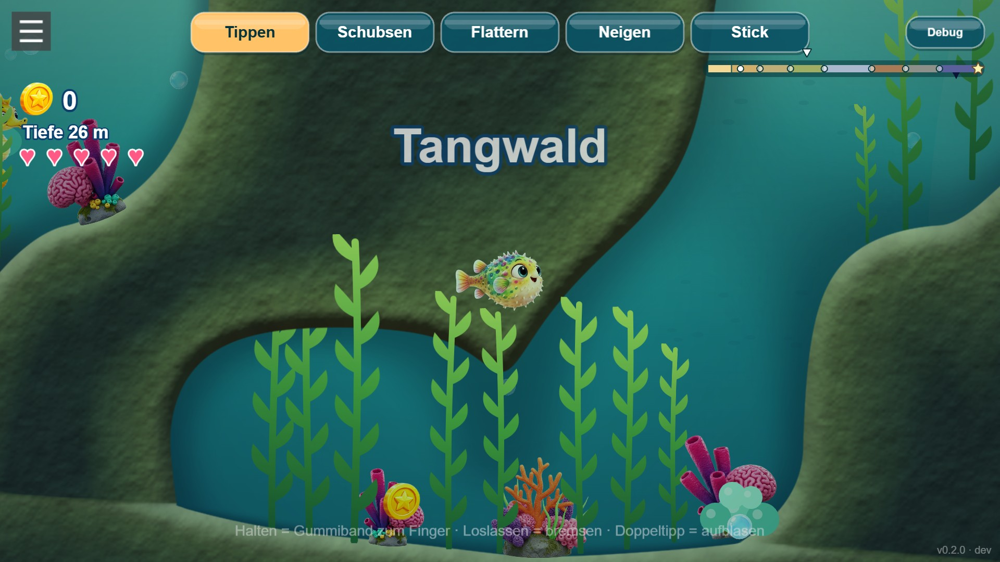
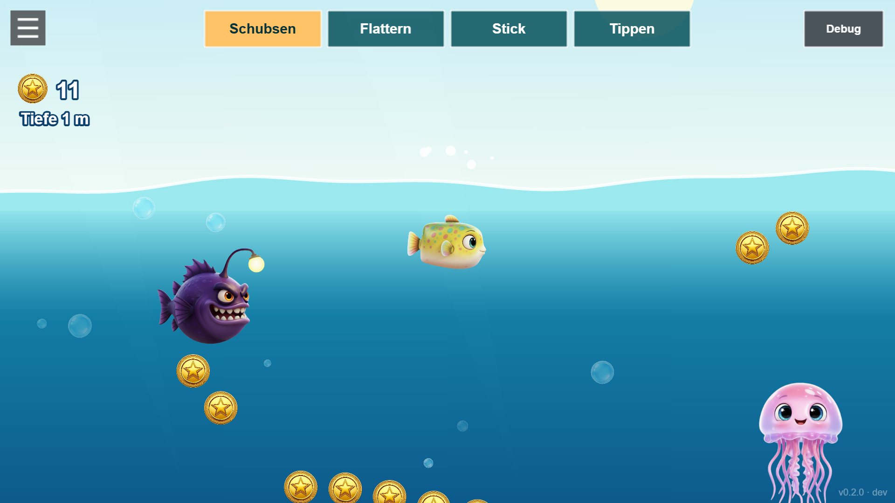

# Super Lompi Land

**▶ Play:** [Release](https://manuelkugelmann.github.io/SuperLompiLand/) · [Dev (latest push)](https://manuelkugelmann.github.io/SuperLompiLand/dev/) · [Multiplayer preview](https://manuelkugelmann.github.io/SuperLompiLand/multiplayer/) · [Two-player split screen](https://manuelkugelmann.github.io/SuperLompiLand/split.html) · [Dev log with screenshots](docs/devlog/README.md)

<!-- devlog:start -->
## Dev log

**Kelp forest with the new per-pixel terrain light: smooth rock, sand on top, shade in the caves** — [`4f0b6bd`](https://github.com/ManuelKugelmann/SuperLompiLand/commit/4f0b6bd) · 2026-11-13 21:59



**Biomes, nests, reef world with lighting, abyss** — [`2ef5125`](https://github.com/ManuelKugelmann/SuperLompiLand/commit/2ef5125) · 2026-11-13 20:15


**Boxfish-shaped Lompi, fin animation, puff as air brake** — [`6d0f7c5`](https://github.com/ManuelKugelmann/SuperLompiLand/commit/6d0f7c5) · 2026-11-13 19:41



[All dev log entries →](docs/devlog/README.md)
<!-- devlog:end -->

A colorful 2D pufferfish game — underwater, Super Mario Land-ish — built as an
installable PWA with **switchable control schemes** for experimentation.

## Stack

- **Phaser 3** + **Matter.js** physics
- **Vite** build
- **PWA** (installable) via `vite-plugin-pwa`

## Run

```bash
npm install
npm run dev        # dev server (service-worker OFF in dev)
npm run build      # production build -> dist/
npm run serve      # zero-dep static server for dist/ (tests the real PWA/SW)
```

## The game

Lompi the pufferfish lives on a reef. A volcano erupts, and what it shakes loose —
mines, nets, buoys — drifts into the sea. Lompi sets out east across the
ocean, from the shallow lagoon through reef, kelp forest, open blue, minefield and
harbour down into the deep trench, to reach the grand nest.

- **Nests** on the seabed save your coins, refill your health and are where you
  continue — also next time you play. Running out of health is never the end.
- **Friends** (turtle, seahorse, snail, starfish, urchin, anglerfish, …) cheer you
  up: a bonus and a heart. They shimmer; hazards do not.
- **Seven characters** to choose on the title screen, each moving differently and
  with its own special (puff, dash, leap, shield, pulse).
- **Relaxed or adventure:** switch in the menu. Relaxed means nothing can hurt.
- The strip at the top right shows the whole journey and where you are.
- **Swim together:** tap *Zusammen* on the title screen and type a secret room
  name (or roll three words with the dice). Everyone who types the same name swims
  in the same sea — up to 4 fish, co-op, everyone keeps their own coins. There is no
  room list; the name never leaves the device (only a derived key reaches the
  public relays that connect the players directly). Friends off screen show as an
  arrow at the edge. Try it alone with the
  [split screen](https://manuelkugelmann.github.io/SuperLompiLand/split.html): two
  players in one window over the real connection. Players connect peer-to-peer by
  default; [`worker/relay`](worker/relay/README.md) is an optional own relay
  (Cloudflare Worker) for networks where that fails — deploy it and set
  `RELAY_URL` in `net/config.js`.

## Controls — switchable live (top of the screen)

| Scheme | Move | Special |
|---|---|---|
| **Tippen** (rubber band) | touch and hold: the fish is pulled to your finger; let go and it brakes | double tap |
| **Schubsen** (air hockey) | grab the fish and throw it, or shove it with your finger | double tap |
| **Flattern** (flap) | every tap is a fin stroke: tap position = direction, tap rate = speed | long press |
| **Neigen** (tilt) | tilt the phone to steer, tap for speed | long press |
| **Stick** | floating virtual stick, drag to swim | double tap |

Keyboard always works too: arrows / WASD swim, Space is the special.
Out of the water there is no swimming — only your momentum, and a little steering.

Sound can be switched off in the menu (☰). The app updates itself when a new build
is live; install it from the same menu.

## Development

```bash
npm test           # unit tests for the pure logic (terrain, biomes, characters, …)
```

Add a control scheme in `game/controls/` and register it in `game/controls/index.js`;
add a playable character in `game/characters.js`; biomes and their spawn tables live
in `game/level/biomes.js`.

## Deploy — GitHub Pages (dev/release routing)

`peaceiris/actions-gh-pages` with `keep_files`:

- `main` → `https://<owner>.github.io/<repo>/` — **release**
- any other branch → `https://<owner>.github.io/<repo>/<slug>/` — **dev preview**
- deleting a branch removes its preview (`cleanup.yml`)

Build base is injected per branch (`--base`), so subfolder deploys resolve assets
correctly. Enable Pages once with source = `gh-pages` branch.

Any static host works too (plain `dist/`): Uberspace (`rsync dist/ → ~/html`),
Netlify / Vercel / Cloudflare Pages (drag-drop or git).

## Layout

```
scenes/        title (character carousel), story intro, game, HUD, end
game/          player fish, characters, control schemes, audio, PWA, feedback
game/level/    world generator, biomes, terrain math, creatures, backdrop
systems/       progression (localStorage)
worker/        feedback relay (Cloudflare Worker)
tests/         unit tests
scripts/       icon generator, static server, dev log helper
```
