# Super Lompi Land

**▶ Play:** [Release](https://manuelkugelmann.github.io/SuperLompiLand/) · [Dev (latest push)](https://manuelkugelmann.github.io/SuperLompiLand/dev/) · [Multiplayer preview](https://manuelkugelmann.github.io/SuperLompiLand/multiplayer/) · [Two-player split screen](https://manuelkugelmann.github.io/SuperLompiLand/split.html) · [Dev log with screenshots](docs/devlog/README.md)

<!-- devlog:start -->
## Dev log

**Nests rebuilt: a level sand basin with raked-sand relief and shells** — [`da155c1`](https://github.com/ManuelKugelmann/SuperLompiLand/commit/da155c1) · 2026-11-14 00:08

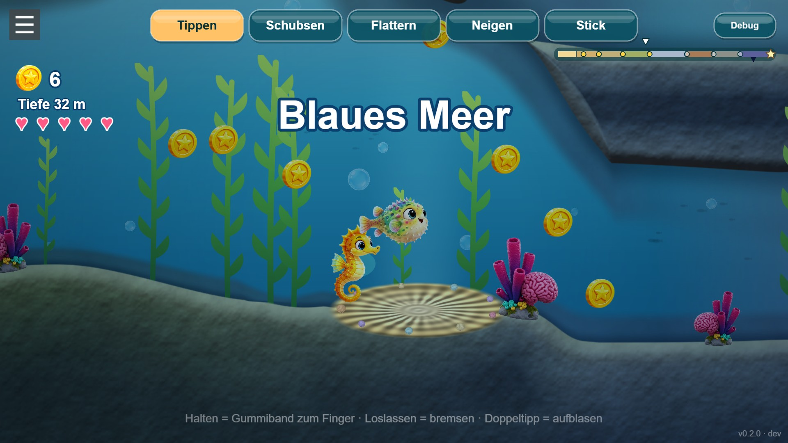

**Lompi in 3D: four techniques compared with the same light and pose** — [`9c70f65`](https://github.com/ManuelKugelmann/SuperLompiLand/commit/9c70f65) · 2026-11-13 23:04

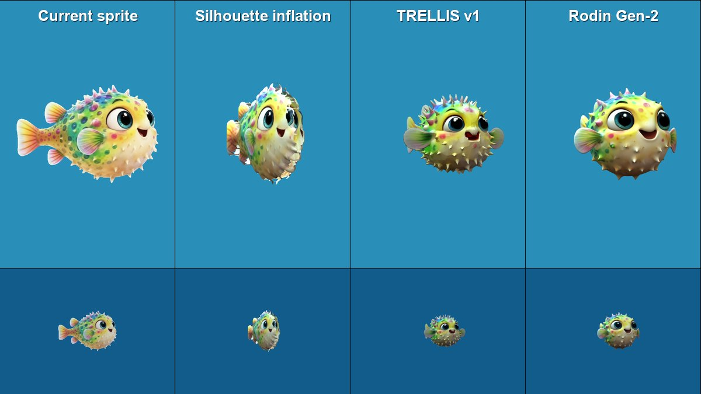

[All dev log entries →](docs/devlog/README.md)
<!-- devlog:end -->

<!-- biomes:start -->
## Biomes, west to east

One shot per biome, captured with `node scripts/capture-biomes.mjs` (start spots via `?at=<biome>`).

<table>
<tr><td width="50%">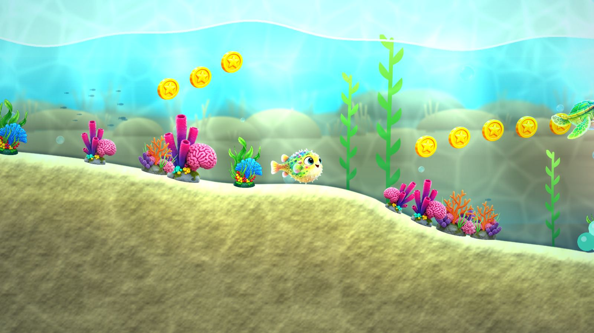<br><b>Sandstrand</b> · Sandy Beach</td><td width="50%">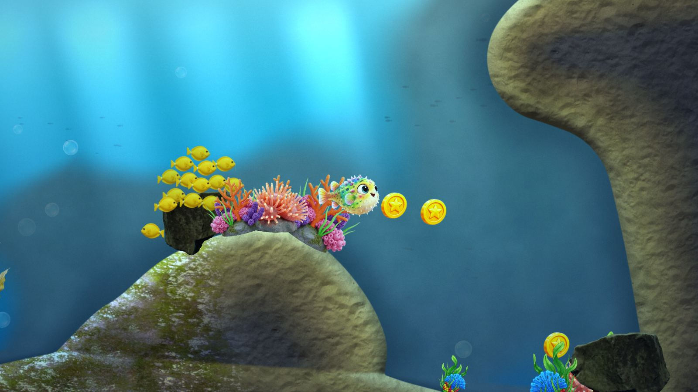<br><b>Heimatriff</b> · Home Reef</td></tr>
<tr><td width="50%">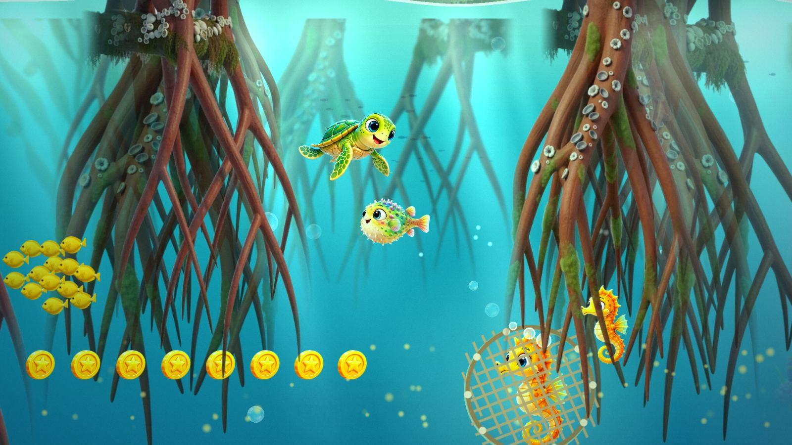<br><b>Mangroven-Lagune</b> · Mangrove Lagoon</td><td width="50%">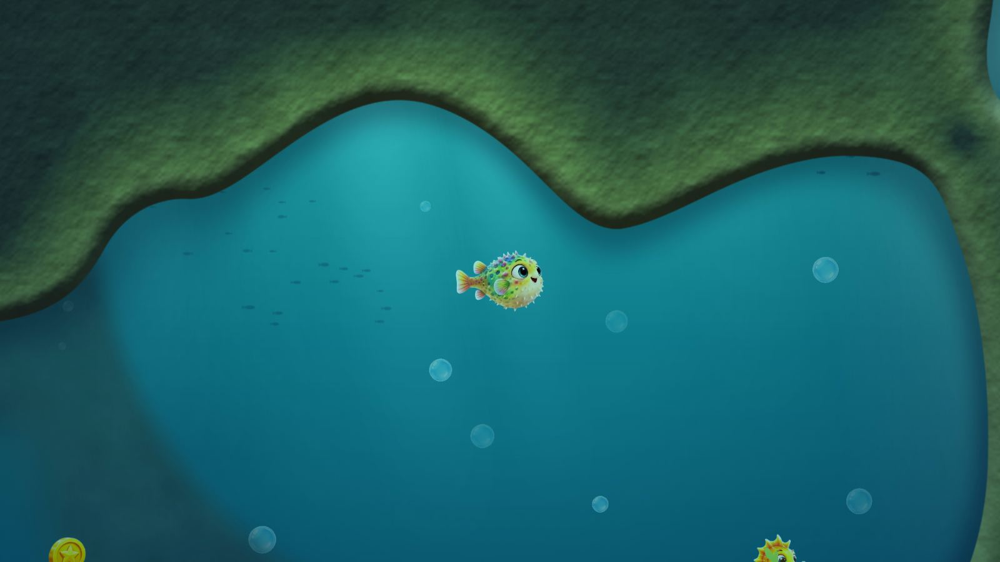<br><b>Tangwald</b> · Kelp Forest</td></tr>
<tr><td width="50%">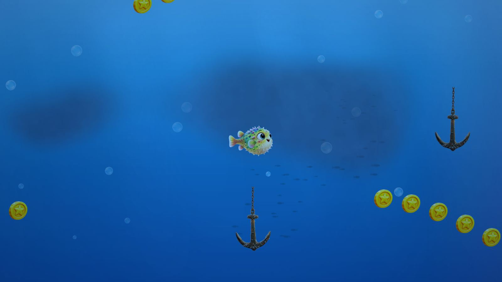<br><b>Blaues Meer</b> · Open Blue</td><td width="50%">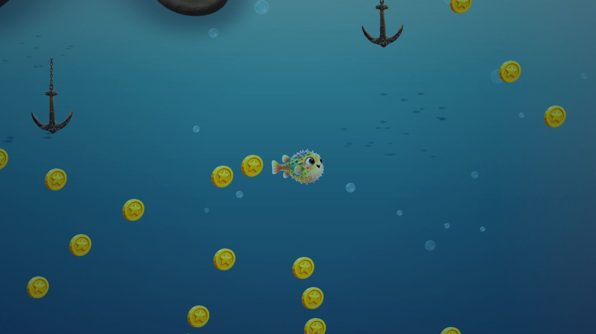<br><b>Schiffsfriedhof</b> · Ship Graveyard</td></tr>
<tr><td width="50%">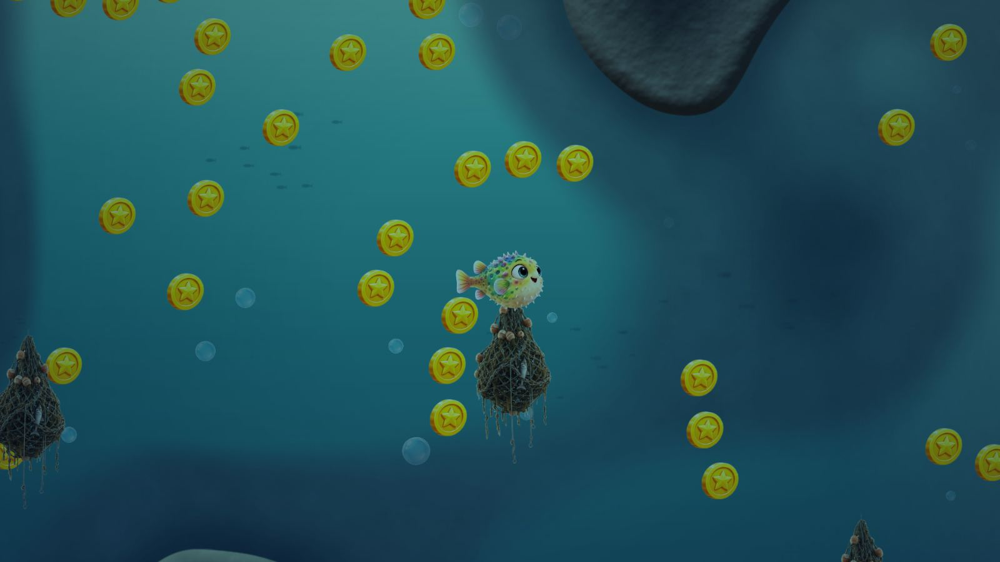<br><b>Hafen</b> · Harbour</td><td width="50%">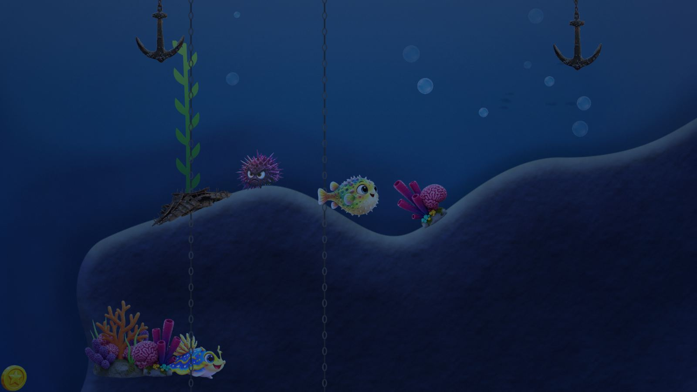<br><b>Tiefsee</b> · Deep Trench</td></tr>
<tr><td width="50%">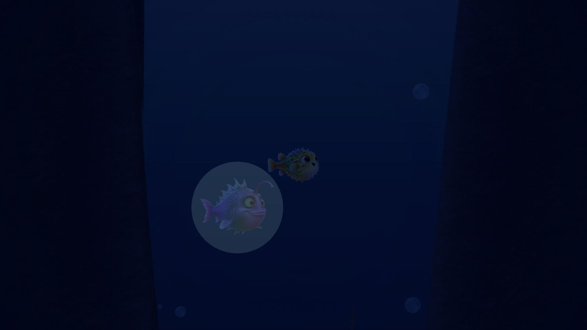<br><b>Abgrund</b> · The Abyss</td><td></td></tr>
</table>
<!-- biomes:end -->

## Animation experiments

How should a character get real volume instead of being a bent flat picture? Candidates
for Lompi, drawn by the same small renderer with the same light and pose, at close-up
size (top) and at game size (bottom). Columns: current sprite · silhouette inflation ·
TRELLIS v1 · Rodin Gen-2. Later rounds are added below; nothing here is removed.

**Round 1 — first look, meshes as generated.** The generated 3D bodies turn as bodies;
the Rodin one keeps the picture's face and colours best and is the current favourite.
Inflating the silhouette does not work for a round body. In exact profile every 3D body
loses the face (the art is a three-quarter view), so characters will swim turned about
30° toward the camera.

Front quarter:


Exact profile, where the face is lost:

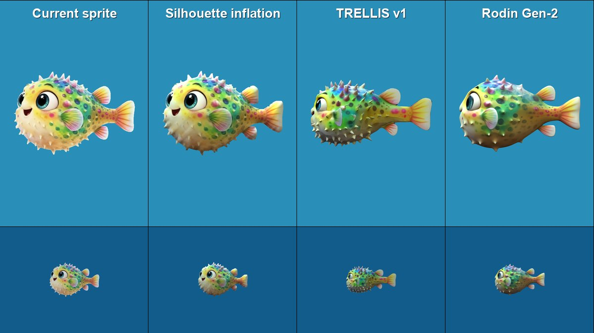

Puff (a simple ball morph for now):

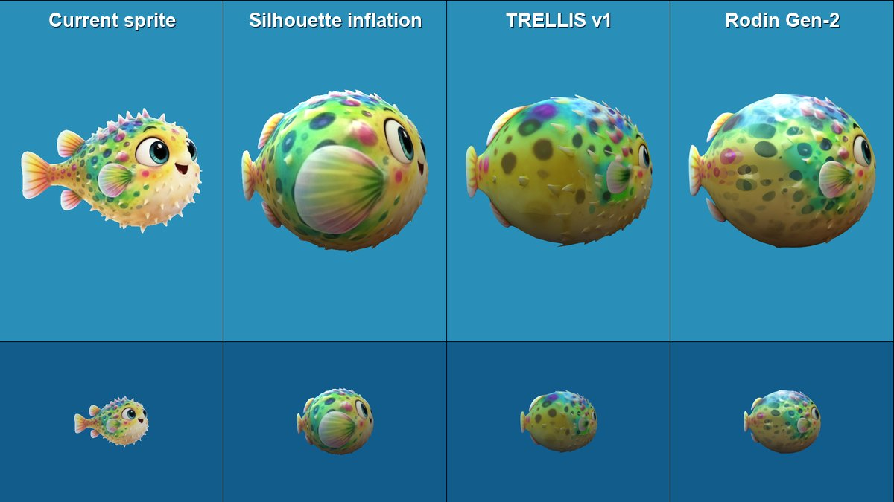

The same four in motion (close-up row; triangles as generated: 2 · 3,860 · 11,856 · full
Rodin mesh). The flat sprite can only mirror, the bodies turn:

Turntable, 60° to either side of the profile:

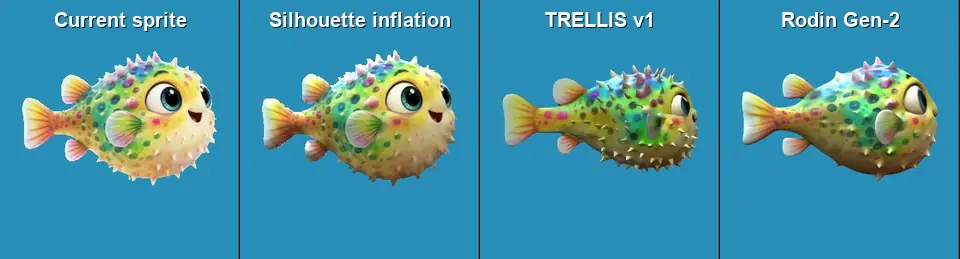

Swim cycle, turned 30° toward the camera:

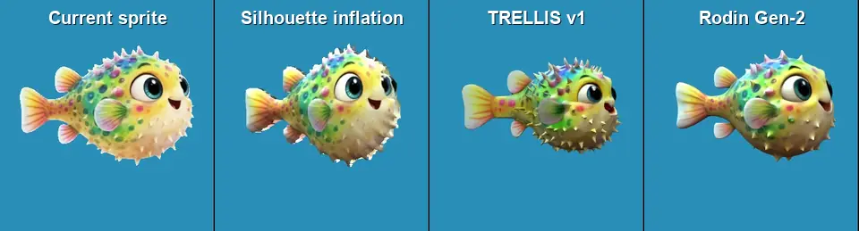

Turn-around:

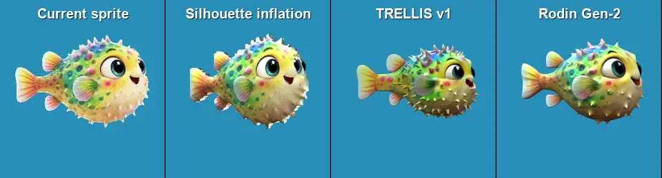

Puff:


**Round 2 — a procedural body in a controlled view.** No full 3D after all: a character
is only ever shown from the angle it was painted from, so its rest pose is the painting
itself. A procedural body — 8 rings of 8 points along the spine, 132 triangles, fitted to
the picture's body — carries the art; the picture's alpha cuts the exact outline, the
triangles only give volume, light and bending. The side fin is a card on its own hinge.
The loop shows swimming, banking 25° to either side, the mirror turn-around and the puff.
The motion is still the viewer's simple test motion, not the final swim drivers, and the
jagged edge when banking away is a known defect of this round.

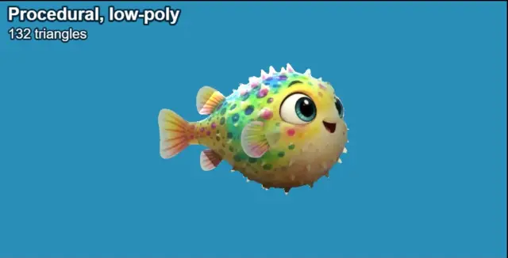

**Round 3, first piece — a procedural eye.** The near eye is no longer painted: it is
drawn by a small shader (eyeball, fibred iris with a dark ring, pupil, two catchlights that
stay with the light, an upper lid) and moved by a gaze model: it holds a fixation and jumps
to a new one in quick saccades instead of gliding, drifts a little, blinks at irregular
intervals, and its pupil widens with fright. The loop: following a circling point, looking
at something close, a fright, sleepy. The far eye is still painted, and the lid is a flat
skin colour for now.


**Round 3, second piece — motion from a swim driver.** No keyframes: the motion is
computed from speed, push and steering. Beat frequency follows the Strouhal relation
(faster and smaller swimmers beat faster); a boxfish like Lompi keeps its body rigid, rows
with the pectoral fin, uses the tail as a rudder and only beats it in a sprint; when the
push stops it glides and the fin trims out, and braking flares it. The loop: slow, medium,
sprint, glide and brake, then banking with steering. Tail, dorsal and anal fins are not
separate cards yet, and breathing and the mouth exist as a tested model without a picture.

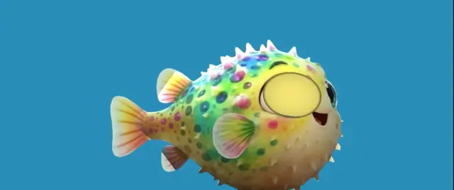

A colorful 2D pufferfish game — underwater, Super Mario Land-ish — built as an
installable PWA with **switchable control schemes** for experimentation.

## Stack

- **Phaser 3** + **Matter.js** physics
- **Vite** build
- **PWA** (installable) via `vite-plugin-pwa`

## Run

```bash
npm install
npm run dev        # dev server (service-worker OFF in dev)
npm run build      # production build -> dist/
npm run serve      # zero-dep static server for dist/ (tests the real PWA/SW)
```

## The game

Lompi the pufferfish lives on a reef. A volcano erupts, and what it shakes loose —
mines, nets, buoys — drifts into the sea. Lompi sets out east across the
ocean, from the shallow lagoon through reef, kelp forest, open blue, minefield and
harbour down into the deep trench, to reach the grand nest.

- **Nests** on the seabed save your coins, refill your health and are where you
  continue — also next time you play. Running out of health is never the end.
- **Friends** (turtle, seahorse, snail, starfish, urchin, anglerfish, …) cheer you
  up: a bonus and a heart. They shimmer; hazards do not.
- **Seven characters** to choose on the title screen, each moving differently and
  with its own special (puff, dash, leap, shield, pulse).
- **Relaxed or adventure:** switch in the menu. Relaxed means nothing can hurt.
- The strip at the top right shows the whole journey and where you are.
- **Swim together:** tap *Zusammen* on the title screen and type a secret room
  name (or roll three words with the dice). Everyone who types the same name swims
  in the same sea — up to 4 fish, co-op, everyone keeps their own coins. There is no
  room list; the name never leaves the device (only a derived key reaches the
  public relays that connect the players directly). Friends off screen show as an
  arrow at the edge. Try it alone with the
  [split screen](https://manuelkugelmann.github.io/SuperLompiLand/split.html): two
  players in one window over the real connection. Players connect peer-to-peer by
  default; [`worker/relay`](worker/relay/README.md) is an optional own relay
  (Cloudflare Worker) for networks where that fails — deploy it and set
  `RELAY_URL` in `net/config.js`.

## Controls — switchable live (top of the screen)

| Scheme | Move | Special |
|---|---|---|
| **Tippen** (rubber band) | touch and hold: the fish is pulled to your finger; let go and it brakes | double tap |
| **Flattern** (flap) | every tap is a fin stroke: tap position = direction, tap rate = speed | long press |
| **Neigen** (tilt) | tilt the phone to steer, tap for speed | long press |
| **Stick** | floating virtual stick, drag to swim | double tap |

Keyboard always works too: arrows / WASD swim, Space is the special.
Out of the water there is no swimming — only your momentum, and a little steering.

Sound can be switched off in the menu (☰). The app updates itself when a new build
is live; install it from the same menu.

## Development

```bash
npm test           # unit tests for the pure logic (terrain, biomes, characters, …)
```

Add a control scheme in `game/controls/` and register it in `game/controls/index.js`;
add a playable character in `game/characters.js`; biomes and their spawn tables live
in `game/level/biomes.js`.

## Deploy — GitHub Pages (dev/release routing)

`peaceiris/actions-gh-pages` with `keep_files`:

- `main` → `https://<owner>.github.io/<repo>/` — **release**
- any other branch → `https://<owner>.github.io/<repo>/<slug>/` — **dev preview**
- deleting a branch removes its preview (`cleanup.yml`)

Build base is injected per branch (`--base`), so subfolder deploys resolve assets
correctly. Enable Pages once with source = `gh-pages` branch.

Any static host works too (plain `dist/`): Uberspace (`rsync dist/ → ~/html`),
Netlify / Vercel / Cloudflare Pages (drag-drop or git).

## Layout

```
scenes/        title (character carousel), story intro, game, HUD, end
game/          player fish, characters, control schemes, audio, PWA, feedback
game/level/    world generator, biomes, terrain math, creatures, backdrop
systems/       progression (localStorage)
worker/        feedback relay (Cloudflare Worker)
tests/         unit tests
scripts/       icon generator, static server, dev log helper
```
