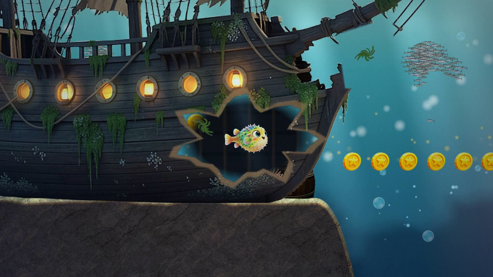
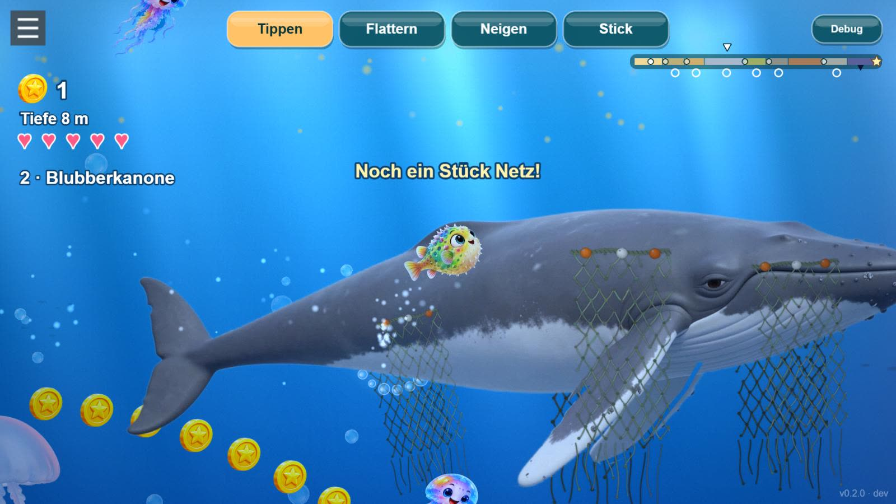
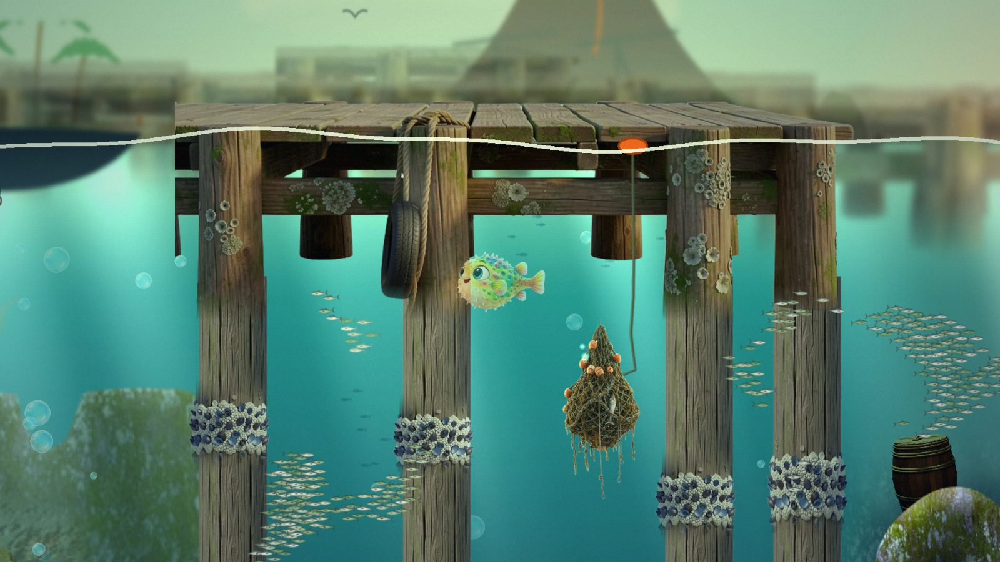
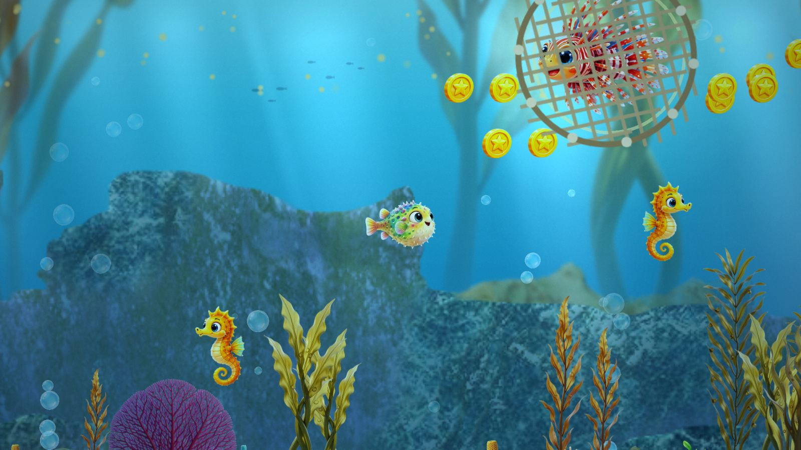

# Super Lompi Land

**▶ Play:** [Release](https://manuelkugelmann.github.io/SuperLompiLand/) · [Dev (latest push)](https://manuelkugelmann.github.io/SuperLompiLand/dev/) · [Multiplayer preview](https://manuelkugelmann.github.io/SuperLompiLand/multiplayer/) · [Two-player split screen](https://manuelkugelmann.github.io/SuperLompiLand/split.html) · [Dev log with screenshots](docs/devlog/README.md)

<!-- devlog:start -->
## Dev log

**Set pieces for the long sea: swim through a ghost ship under the storm, dive down the trench past glowing deep-sea life to the grand nest; a painted story opening** — [`9d45a47`](https://github.com/ManuelKugelmann/SuperLompiLand/commit/9d45a47) · 2026-11-14 13:20



**An island chain: the great whale in the open blue, a storm to dive under, currents that pull deep, gannets that hunt near the coasts** — [`8489824`](https://github.com/ManuelKugelmann/SuperLompiLand/commit/8489824) · 2026-11-14 11:40



**A world above the water: every area has its own coast on the horizon, and the volcano in the east comes closer as you travel** — [`a087bf8`](https://github.com/ManuelKugelmann/SuperLompiLand/commit/a087bf8) · 2026-11-14 11:06



[All dev log entries →](docs/devlog/README.md)
<!-- devlog:end -->

<!-- biomes:start -->
## Biomes, west to east

One shot per biome, captured with `node scripts/capture-biomes.mjs` (start spots via `?at=<biome>`).

<table>
<tr><td width="50%"><br><b>Flache Lagune</b> · Shallow Lagoon</td><td width="50%"><br><b>Mangroven</b> · Mangroves</td></tr>
<tr><td width="50%"><br><b>Korallenriff</b> · Coral Reef</td><td width="50%"><br><b>Blaues Meer</b> · Open Blue</td></tr>
<tr><td width="50%"><br><b>Tangwald</b> · Kelp Forest</td><td width="50%"><br><b>Hafen</b> · Harbour</td></tr>
<tr><td width="50%"><br><b>Schiffsfriedhof</b> · Ship Graveyard</td><td width="50%"><br><b>Felsenküste</b> · Rocky Shore</td></tr>
<tr><td width="50%"><br><b>Tiefsee</b> · Deep Trench</td><td width="50%"><br><b>Abgrund</b> · The Abyss</td></tr>
</table>
<!-- biomes:end -->

## Animation experiments

How should a character get real volume instead of being a bent flat picture? Candidates
for Lompi, drawn by the same small renderer with the same light and pose, at close-up
size (top) and at game size (bottom). Columns: current sprite · silhouette inflation ·
TRELLIS v1 · Rodin Gen-2. Later rounds are added below; nothing here is removed.

**Round 1 — first look, meshes as generated.** The generated 3D bodies turn as bodies;
the Rodin one keeps the picture's face and colours best and is the current favourite.
Inflating the silhouette does not work for a round body. In exact profile every 3D body
loses the face (the art is a three-quarter view), so characters will swim turned about
30° toward the camera.

Front quarter:


Exact profile, where the face is lost:


Puff (a simple ball morph for now):


The same four in motion (close-up row; triangles as generated: 2 · 3,860 · 11,856 · full
Rodin mesh). The flat sprite can only mirror, the bodies turn:

Turntable, 60° to either side of the profile:


Swim cycle, turned 30° toward the camera:


Turn-around:


Puff:


**Round 2 — a procedural body in a controlled view.** No full 3D after all: a character
is only ever shown from the angle it was painted from, so its rest pose is the painting
itself. A procedural body — 8 rings of 8 points along the spine, 132 triangles, fitted to
the picture's body — carries the art; the picture's alpha cuts the exact outline, the
triangles only give volume, light and bending. The side fin is a card on its own hinge.
The loop shows swimming, banking 25° to either side, the mirror turn-around and the puff.
The motion is still the viewer's simple test motion, not the final swim drivers, and the
jagged edge when banking away is a known defect of this round.


**Round 3, first piece — a procedural eye.** The near eye is no longer painted: it is
drawn by a small shader (eyeball, fibred iris with a dark ring, pupil, two catchlights that
stay with the light, an upper lid) and moved by a gaze model: it holds a fixation and jumps
to a new one in quick saccades instead of gliding, drifts a little, blinks at irregular
intervals, and its pupil widens with fright. The loop: following a circling point, looking
at something close, a fright, sleepy. The far eye is still painted, and the lid is a flat
skin colour for now.


**Round 3, second piece — motion from a swim driver.** No keyframes: the motion is
computed from speed, push and steering. Beat frequency follows the Strouhal relation
(faster and smaller swimmers beat faster); a boxfish like Lompi keeps its body rigid, rows
with the pectoral fin, uses the tail as a rudder and only beats it in a sprint; when the
push stops it glides and the fin trims out, and braking flares it. The loop: slow, medium,
sprint, glide and brake, then banking with steering. Tail, dorsal and anal fins are not
separate cards yet, and breathing and the mouth exist as a tested model without a picture.


A colorful 2D pufferfish game — underwater, Super Mario Land-ish — built as an
installable PWA with **switchable control schemes** for experimentation.

## Stack

- **Phaser 3** + **Matter.js** physics
- **Vite** build
- **PWA** (installable) via `vite-plugin-pwa`

## Run

```bash
npm install
npm run dev        # dev server (service-worker OFF in dev)
npm run build      # production build -> dist/
npm run serve      # zero-dep static server for dist/ (tests the real PWA/SW)
```

## The game

Lompi the pufferfish lives in a lagoon. A volcano erupts far in the east, and what it
shakes loose — lost anchors, nets, rusty drums — drifts into the sea; Lompi's friends are
scattered. Lompi sets out east along a chain of islands: from the home island (lagoon,
mangroves, coral reef) over the reef's edge into the open sea, past the kelp island and
its harbour, across a stormy sea with wrecks far below, along a rocky shore and down into
the deep trench, to reach the grand nest.

- **A story you cannot lose:** every stretch has a goal, shown when you arrive. On the
  islands and out at sea a friend hangs in a ghost net right on the way; swim up and it
  is free, dances and swims on. The strip at the top right shows who is found.
- **The great whale** waits in the open blue with net wrapped round her. Tear it off
  piece by piece and she sings, then carries you east on her back.
- **A ghost ship** stands on a pinnacle of rock under the storm, lanterns still lit; the
  way on leads through the hole in its bow. In the trench the way goes down and down,
  toward the glow of the grand nest.
- **Islands and open sea:** along a coast the water is shallow and full of life; between
  the islands the bottom is far below and the way across runs just under the surface.
  A storm closes the surface for a stretch (the way on is underneath), and a current
  pulls down into the deep and lifts you up again further on.
- **The coast moves:** in the surf on the beach the water pushes in and pulls back with
  every wave; on the reef's edge breakers come in sets, with a quiet gap to cross.
  Seabirds dive after shoals near the islands (and after a careless fish at the surface).
- **Nests** on the seabed save your coins, refill your health and are where you
  continue — also next time you play. Running out of health is never the end.
- **Friends** (turtle, seahorse, snail, starfish, urchin, anglerfish, …) cheer you
  up: a bonus and a heart. They shimmer; hazards do not.
- **Seven characters** to choose on the title screen, each moving differently and
  with a special of its own: Lompi puffs up and stops, Sharky sprints (tap up to five
  times), Flitzi leaps and glides over the waves, the firefish spreads its fins like a
  parachute, Schildi tucks into a rolling shell, Quallina pulses upward, Hüpfi holds on
  to the rock with its tail.
- **Momentum from the sea:** currents carry you faster than you can swim, bubble
  cannons at their ends shoot you on, a big moon jelly bounces you back up.
- **Chains:** link jumps, flips, clean landings, wave skips, currents, cannons and
  specials and a soft counter grows; a finished chain pays a few bonus coins. No timer,
  nothing to lose.
- **A calm route** of open water runs through the whole journey, past every nest;
  hazards keep away from it, and little lights drift along it. Danger is optional.
- **Animals with a mind of their own:** friends roam, rest, look at you, circle you
  once to say hello and dart off when rushed; the turtle comes up for air, starfish and
  snails crawl along the rock.
- **Relaxed or adventure:** switch in the menu. Relaxed means nothing can hurt.
- The strip at the top right shows the whole journey and where you are.
- **Swim together:** tap *Zusammen* on the title screen and type a secret room
  name (or roll three words with the dice). Everyone who types the same name swims
  in the same sea — up to 4 fish, co-op, everyone keeps their own coins. There is no
  room list; the name never leaves the device (only a derived key reaches the
  public relays that connect the players directly). Friends off screen show as an
  arrow at the edge. Try it alone with the
  [split screen](https://manuelkugelmann.github.io/SuperLompiLand/split.html): two
  players in one window over the real connection. Players connect peer-to-peer by
  default; [`worker/relay`](worker/relay/README.md) is an optional own relay
  (Cloudflare Worker) for networks where that fails — deploy it and set
  `RELAY_URL` in `net/config.js`.

## Controls — switchable live (top of the screen)

| Scheme | Move | Special |
|---|---|---|
| **Tippen** (rubber band) | touch and hold: the fish is pulled to your finger; let go and it brakes | double tap |
| **Flattern** (flap) | every tap is a fin stroke: tap position = direction, tap rate = speed | long press |
| **Neigen** (tilt) | tilt the phone to steer, tap for speed | long press |
| **Stick** | floating virtual stick, drag to swim | double tap |

Keyboard always works too: arrows / WASD swim, Space is the special.
Out of the water you fly like a bird: steering turns your path and never adds speed,
a dive gains speed, and puffing up is the air brake.

Sound can be switched off in the menu (☰). The app updates itself when a new build
is live; install it from the same menu.

## Development

```bash
npm test           # unit tests for the pure logic (terrain, biomes, characters, …)
```

Add a control scheme in `game/controls/` and register it in `game/controls/index.js`;
add a playable character in `game/characters.js` and its special in `game/specials.js`;
biomes and their spawn tables live in `game/level/biomes.js`.

Handy while developing (add to the URL):

| Parameter | What it does |
|---|---|
| `?at=<biome>` or `?at=x,y` | start at a biome's landmark or at a point |
| `?debug=perf` | frame budget, chunk build times, object counts |
| `?perftest=1` | hops along the whole calm route and reports, per biome, the worst logic time, chunk build time, object and tween counts against the budgets |
| `?debug=flow` | currents as arrows, the calm route as a green line |
| `?debug=ai` | every creature shows what it is doing |
| `?tune=key:value,...` | override movement numbers, e.g. `?tune=waterDrag:0.5,thrust:0.0009` |
| `?flight=ballistic` | the old flight model, for comparison |

## Deploy — GitHub Pages (dev/release routing)

`peaceiris/actions-gh-pages` with `keep_files`:

- `main` → `https://<owner>.github.io/<repo>/` — **release**
- any other branch → `https://<owner>.github.io/<repo>/<slug>/` — **dev preview**
- deleting a branch removes its preview (`cleanup.yml`)

Build base is injected per branch (`--base`), so subfolder deploys resolve assets
correctly. Enable Pages once with source = `gh-pages` branch.

Any static host works too (plain `dist/`): Uberspace (`rsync dist/ → ~/html`),
Netlify / Vercel / Cloudflare Pages (drag-drop or git).

## Layout

```
scenes/        title (character carousel), story intro, game, HUD, end
game/          player fish, characters, control schemes, audio, PWA, feedback
game/level/    world generator, biomes, terrain math, creatures, backdrop
systems/       progression (localStorage)
worker/        feedback relay (Cloudflare Worker)
tests/         unit tests
scripts/       icon generator, static server, dev log helper
```

## Credits

A game by **Familie Kugelmann**.

- Stone and metal surfaces (`public/img/mat/`): [ambientCG](https://ambientcg.com) — CC0
  (Ground054, Rock029, Rock057, Rock055, Rock035, Metal021), reduced to 512-px tiles.
- Seabed props (`public/img/props/`): rendered from [Poly Haven](https://polyhaven.com) models — CC0
  (dutch_ship_medium, rock_moss_set_01/02, wooden_barrels_01, wooden_crate_02).
- [Phaser](https://phaser.io), [Matter.js](https://brm.io/matter-js/), [Vite](https://vitejs.dev),
  [Trystero](https://github.com/dmotz/trystero) — MIT.

The same list is in the game menu (Danke / Credits), see `game/credits.js`.
