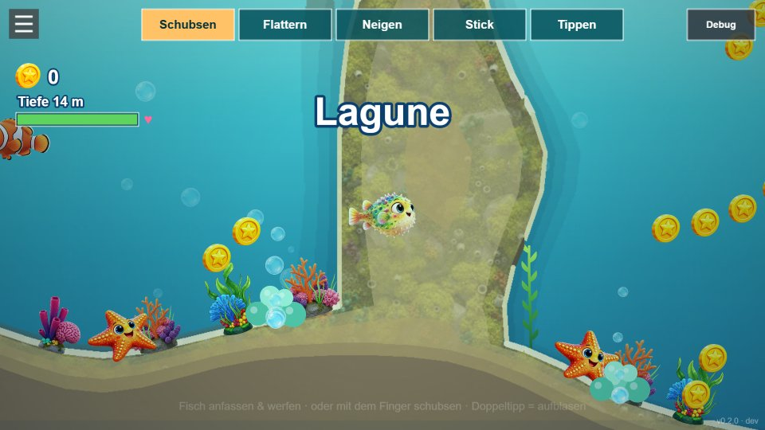
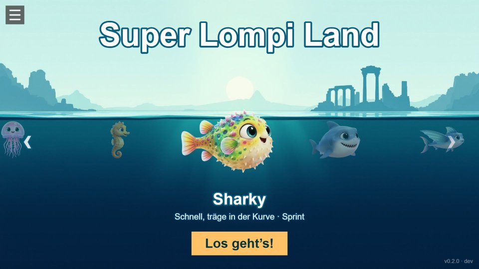
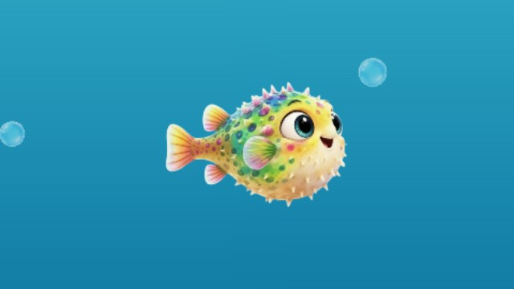

# Super Lompi Land

**▶ Play:** [Release](https://manuelkugelmann.github.io/SuperLompiLand/) · [Dev (latest push)](https://manuelkugelmann.github.io/SuperLompiLand/dev/) · [Dev log with screenshots](docs/devlog/README.md)

<!-- devlog:start -->
## Dev log

**Biomes, nests, reef world with lighting, abyss** — [`2ef5125`](https://github.com/ManuelKugelmann/SuperLompiLand/commit/2ef5125) · 2026-11-13 20:15



**Playable characters with a title carousel, health bar, tilt controls** — [`84b4750`](https://github.com/ManuelKugelmann/SuperLompiLand/commit/84b4750) · 2026-11-13 20:00



**Fin and tail animation, clean turn-around** — [`9ff697e`](https://github.com/ManuelKugelmann/SuperLompiLand/commit/9ff697e) · 2026-11-13 19:46



[All dev log entries →](docs/devlog/README.md)
<!-- devlog:end -->

A colorful 2D pufferfish game — underwater, Super Mario Land-ish — built as an
installable PWA with **switchable control schemes** for experimentation.

## Stack

- **Phaser 3** + **Matter.js** physics
- **Vite** build
- **PWA** (installable) via `vite-plugin-pwa`

## Run

```bash
npm install
npm run dev        # dev server (service-worker OFF in dev)
npm run build      # production build -> dist/
npm run serve      # zero-dep static server for dist/ (tests the real PWA/SW)
```

## Controls — switchable live (top-center switcher)

Swap any time in-game:

| Scheme | Move | Puff |
|---|---|---|
| **Schubsen** (air hockey) | grab the fish and throw it, or shove it with your finger as a paddle | double tap |
| **Flattern** (flap) | every tap is a fin stroke: tap position = direction, tap rate = speed | long press |
| **Stick** | floating virtual stick, drag to swim | double tap |
| **Tippen** (rubber band) | touch and hold: the fish is pulled to your finger; let go and it brakes | double tap |

Keyboard always works too: arrows / WASD swim, Space puffs.

The pufferfish has two states — normal (small, agile) and inflated (big, buoyant,
shrugs off hazards). The world is an open 2D ocean generated from a seed: swim in
any direction, dive deeper, meet friends, avoid urchins, mines and anglerfish.

Add a scheme in `game/controls/` and register it in `game/controls/index.js` — it
appears in the switcher automatically. A physics-debug toggle is top-right.
The app updates itself when a new build is live; install / update are also in the menu (☰).

## Deploy — GitHub Pages (dev/release routing)

`peaceiris/actions-gh-pages` with `keep_files`:

- `main` → `https://<owner>.github.io/<repo>/` — **release**
- any other branch → `https://<owner>.github.io/<repo>/<slug>/` — **dev preview**
- deleting a branch removes its preview (`cleanup.yml`)

Build base is injected per branch (`--base`), so subfolder deploys resolve assets
correctly. Enable Pages once with source = `gh-pages` branch.

Any static host works too (plain `dist/`): Uberspace (`rsync dist/ → ~/html`),
Netlify / Vercel / Cloudflare Pages (drag-drop or git).

## Layout

```
scenes/        Intro / Main / End
game/          Pufferfish, control schemes, level generator, UI, orientation, PWA
public/img/    generated art
systems/       progression (localStorage)
scripts/       icon generator, static server
```
