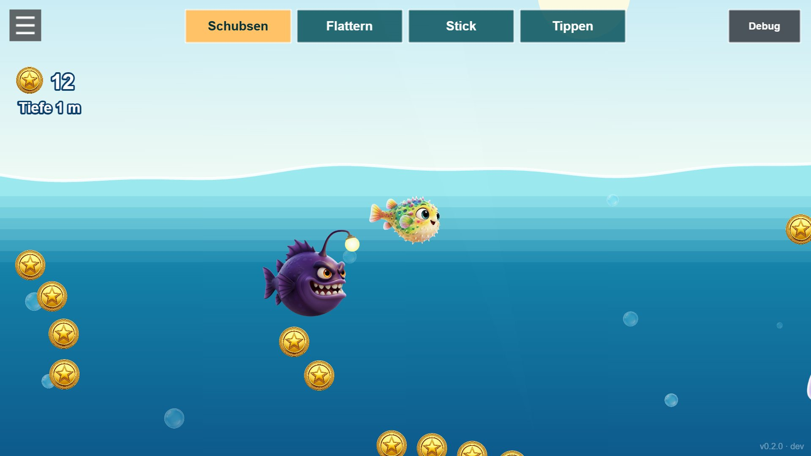
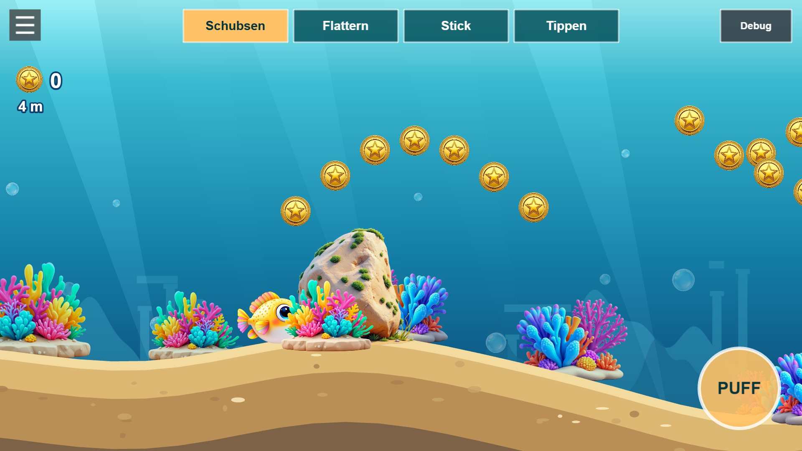

# Dev log

Screenshots from development, newest first. Each entry links to the commit it was taken from.

## Biomes, nests, reef world with lighting, abyss

[`2ef5125`](https://github.com/ManuelKugelmann/SuperLompiLand/commit/2ef5125) · 2026-11-13 20:15

## Boxfish-shaped Lompi, fin animation, puff as air brake

[`6d0f7c5`](https://github.com/ManuelKugelmann/SuperLompiLand/commit/6d0f7c5) · 2026-11-13 19:41

## Waves at the surface, jumping out of the water

[`47d2cff`](https://github.com/ManuelKugelmann/SuperLompiLand/commit/47d2cff) · 2026-11-13 19:37

## Open 2D ocean with the cast: jellyfish, starfish, angler, friends

[`5ed6327`](https://github.com/ManuelKugelmann/SuperLompiLand/commit/5ed6327) · 2026-11-13 19:28

## Friends, moving enemies, current streams, bubble trail

[`0d3c6de`](https://github.com/ManuelKugelmann/SuperLompiLand/commit/0d3c6de) · 2026-11-13 19:16

## First playable: endless seabed, generated art, shove/flap/stick/tap controls

[`3f4f178`](https://github.com/ManuelKugelmann/SuperLompiLand/commit/3f4f178) · 2026-11-13 19:14

