# Dev log

Screenshots from development, newest first. Each entry links to the commit it was taken from.

## Biomes, nests, reef world with lighting, abyss

[`2ef5125`](https://github.com/ManuelKugelmann/SuperLompiLand/commit/2ef5125) · 2026-11-13 20:15

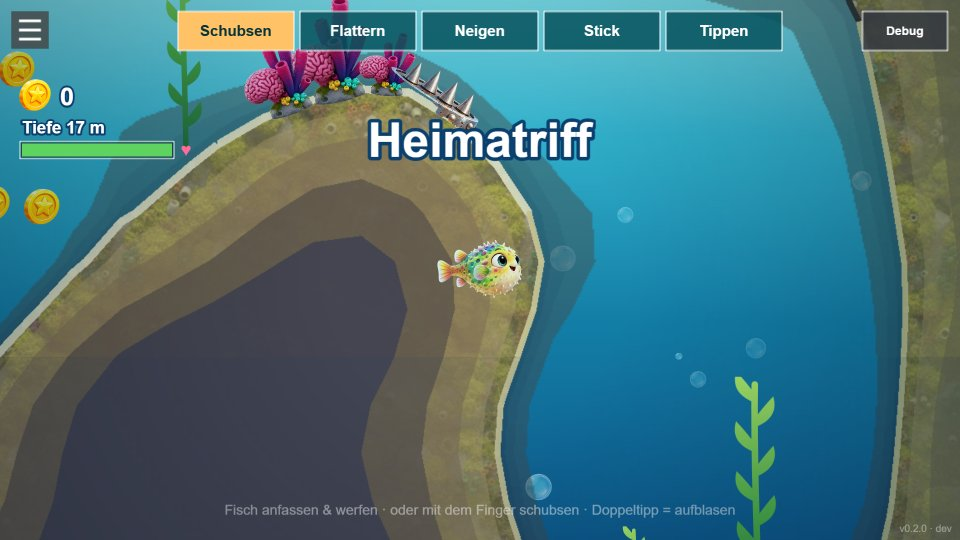

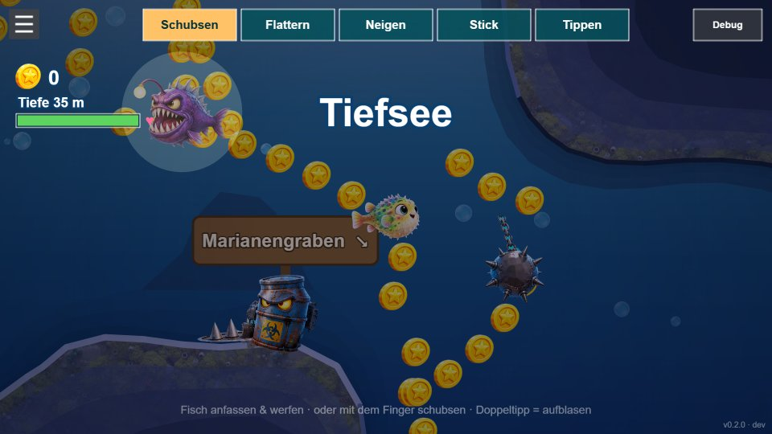

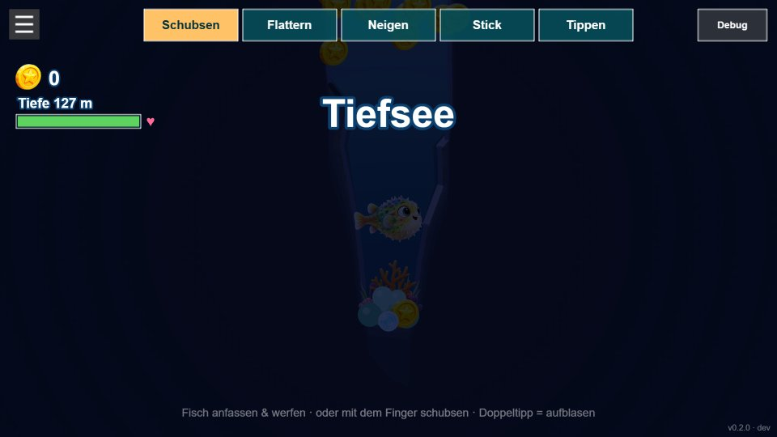

## Playable characters with a title carousel, health bar, tilt controls

[`84b4750`](https://github.com/ManuelKugelmann/SuperLompiLand/commit/84b4750) · 2026-11-13 20:00

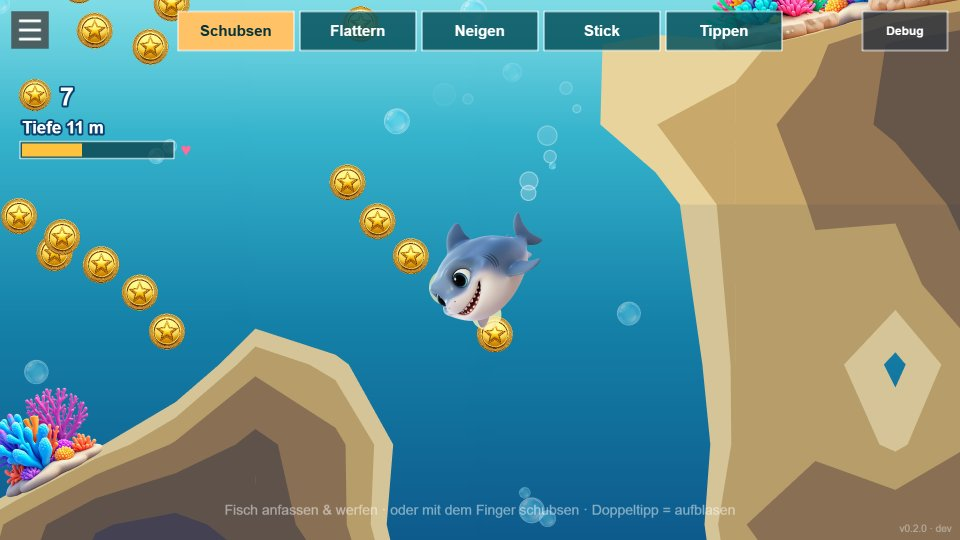

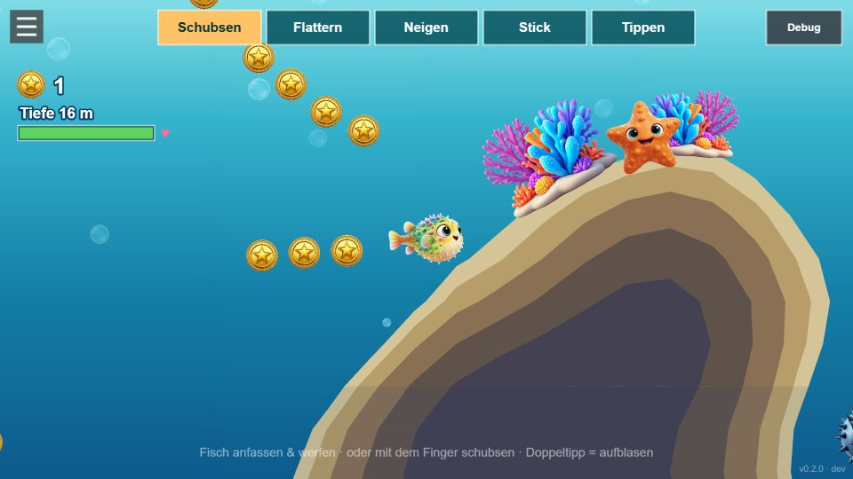

## Fin and tail animation, clean turn-around

[`9ff697e`](https://github.com/ManuelKugelmann/SuperLompiLand/commit/9ff697e) · 2026-11-13 19:46

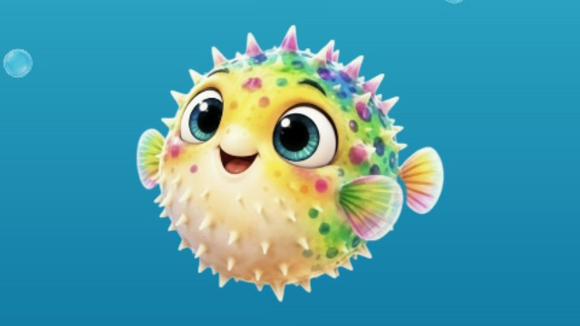

## Smooth interpolated movement, subtler control overlays

[`b045ca6`](https://github.com/ManuelKugelmann/SuperLompiLand/commit/b045ca6) · 2026-11-13 19:39

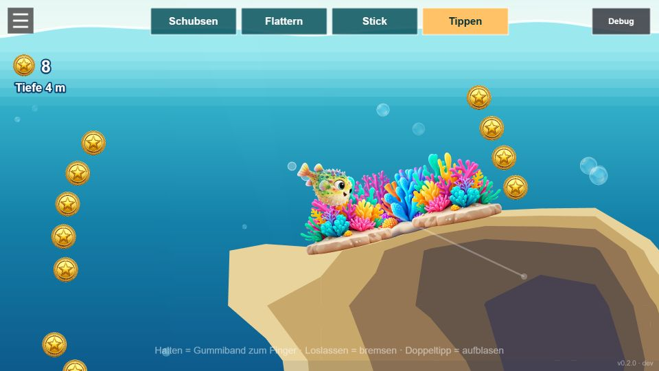

## Waves at the surface, jumping out of the water, version tag

[`47d2cff`](https://github.com/ManuelKugelmann/SuperLompiLand/commit/47d2cff) · 2026-11-13 19:37

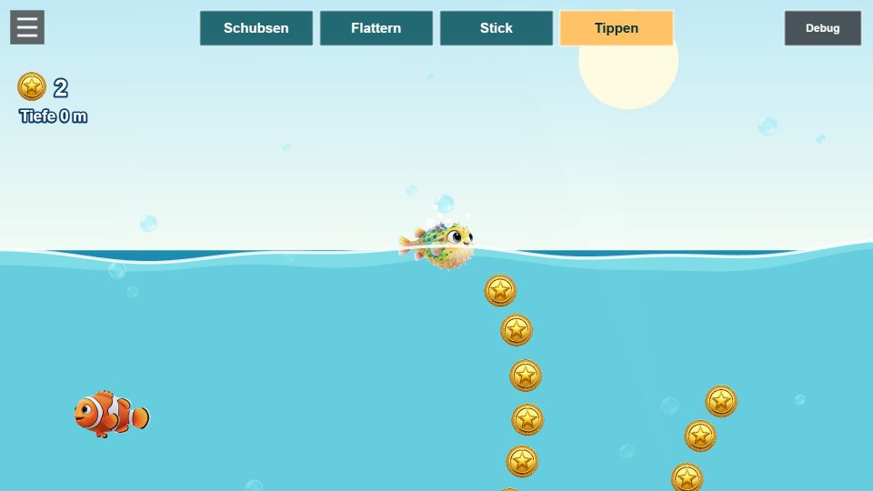

## Open 2D ocean, self-updating PWA, Lompi redrawn after the look-dev, friends

[`5ed6327`](https://github.com/ManuelKugelmann/SuperLompiLand/commit/5ed6327) · 2026-11-13 19:28

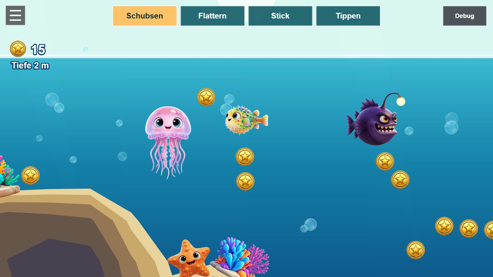

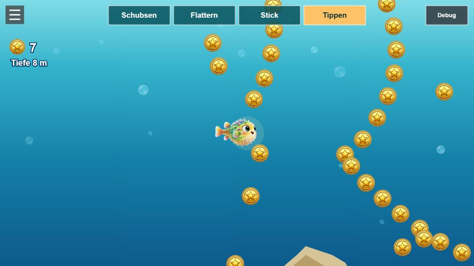

## First playable: endless seabed, generated art, shove/flap/stick/tap controls

[`3f4f178`](https://github.com/ManuelKugelmann/SuperLompiLand/commit/3f4f178) · 2026-11-13 19:14

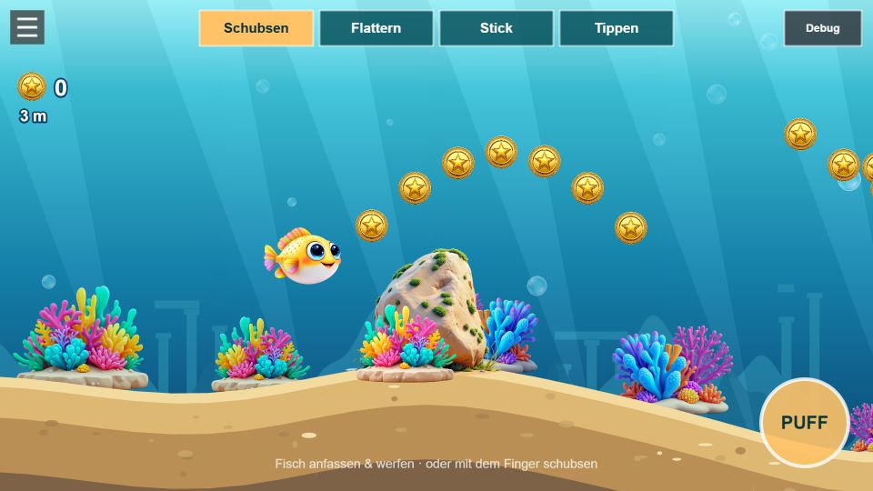

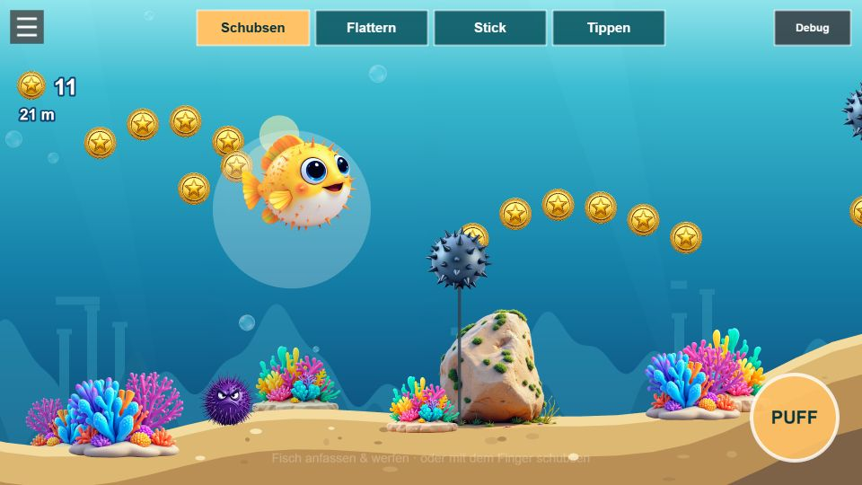
