# Dev log

Screenshots from development, newest first. Each entry links to the commit it was taken from.

## A wreck greets you in the ship graveyard: every biome shows its landmark where you arrive

[`3c01d46`](https://github.com/ManuelKugelmann/SuperLompiLand/commit/3c01d46) · 2026-11-14 03:12

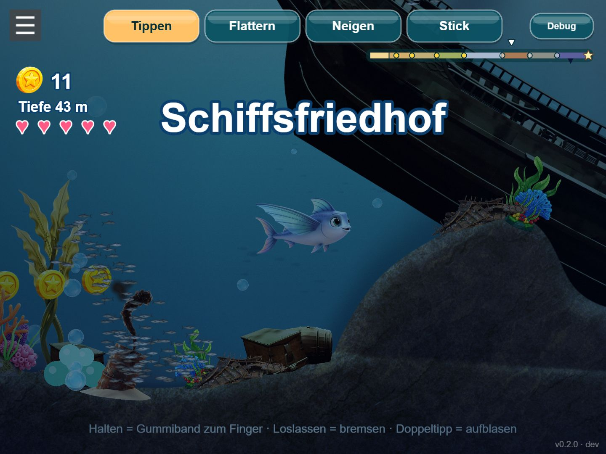

## A world that holds together: harbour pier, painted mangrove roots, caves with back walls, a glowing main route

[`578708a`](https://github.com/ManuelKugelmann/SuperLompiLand/commit/578708a) · 2026-11-14

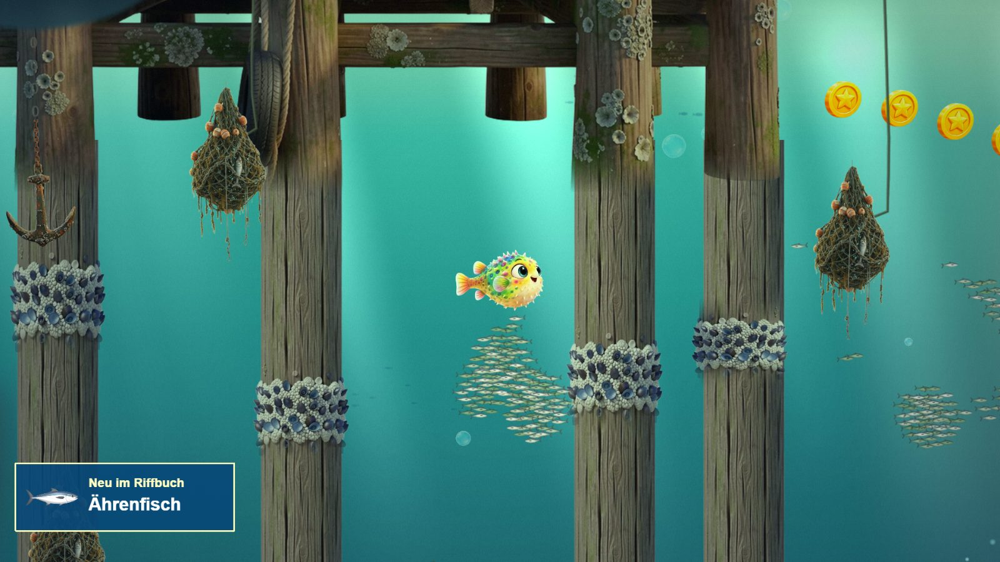
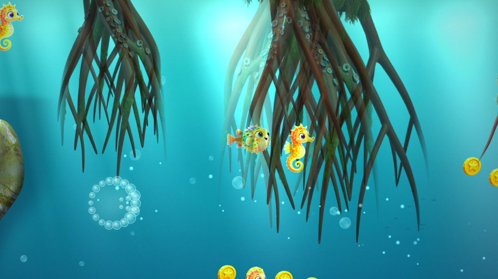
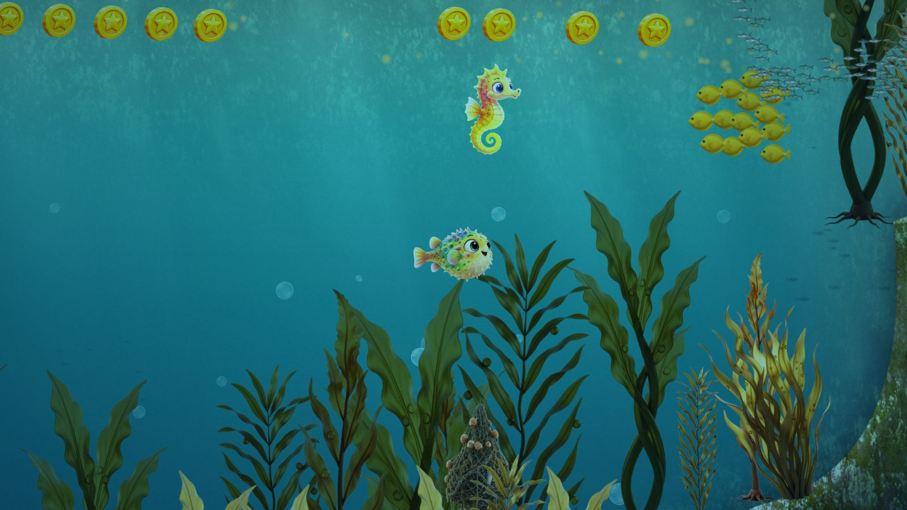

## Chains of jumps, flips and specials; bird-like flight; a special of its own for every character

[`56b92fc`](https://github.com/ManuelKugelmann/SuperLompiLand/commit/56b92fc) · 2026-11-14 01:23

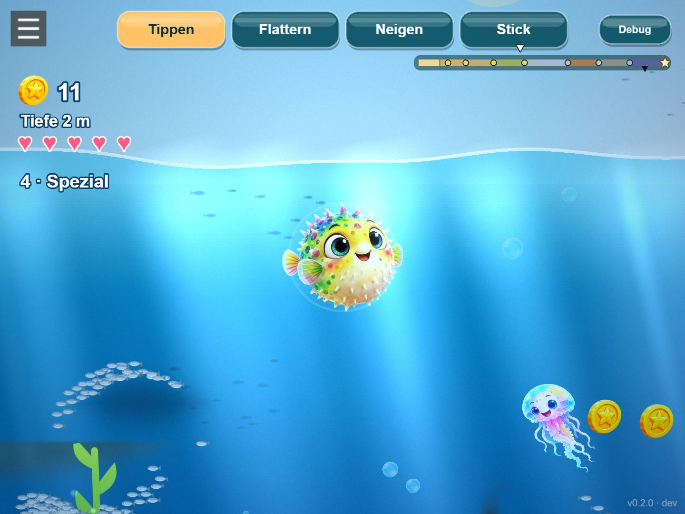

## Shoals: anthias, tangs and silversides that part around Lompi and flee from Sharky

[`7dc9bf4`](https://github.com/ManuelKugelmann/SuperLompiLand/commit/7dc9bf4) · 2026-11-14

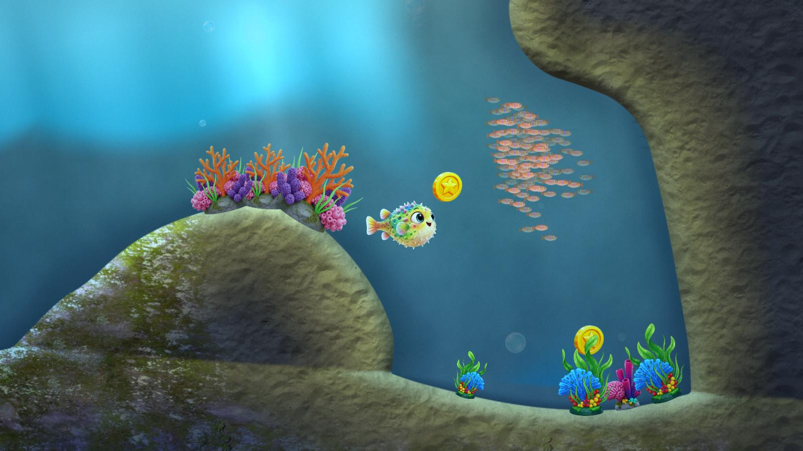
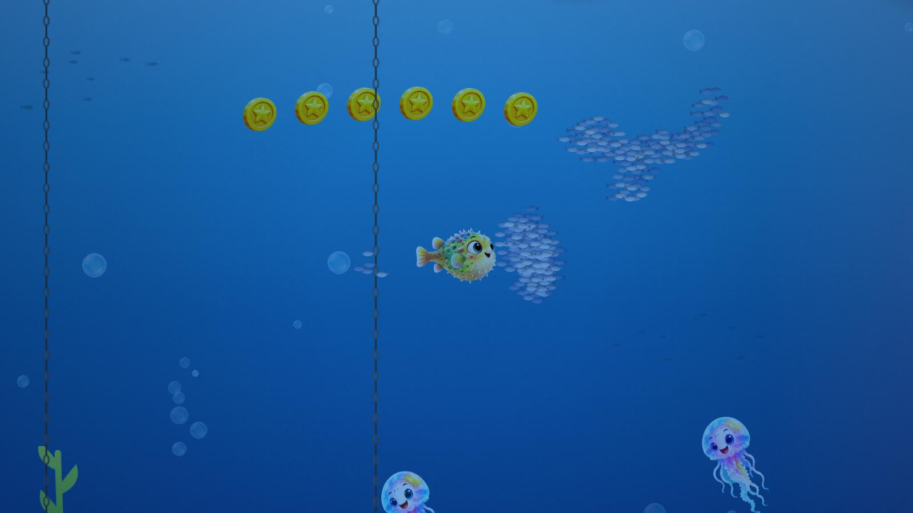

## Nests rebuilt: a level sand basin with raked-sand relief and shells

[`da155c1`](https://github.com/ManuelKugelmann/SuperLompiLand/commit/da155c1) · 2026-11-14 00:08

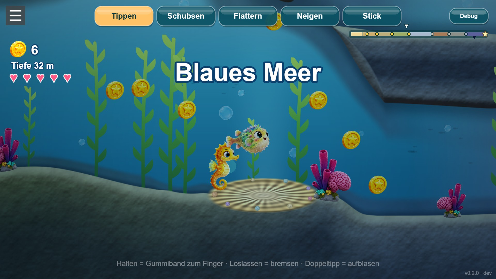

## Lompi in 3D: four techniques compared with the same light and pose

[`9c70f65`](https://github.com/ManuelKugelmann/SuperLompiLand/commit/9c70f65) · 2026-11-13 23:04

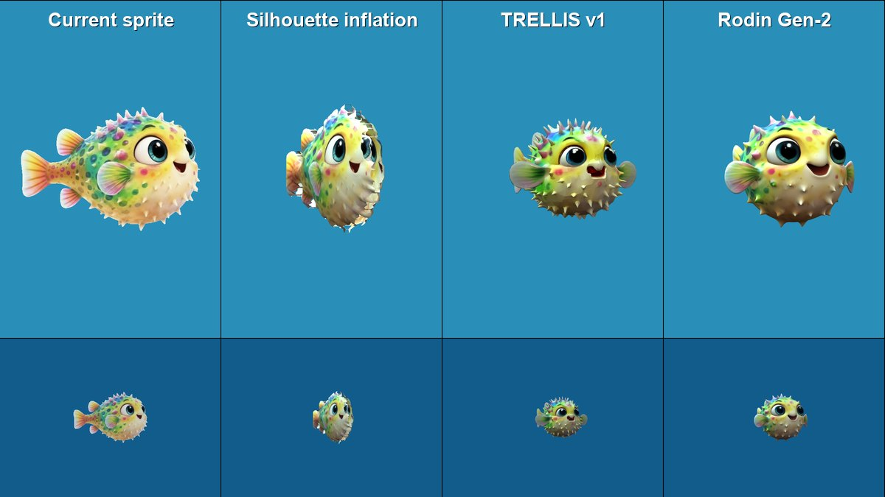

## Kelp forest with the new per-pixel terrain light: smooth rock, sand on top, shade in the caves

[`4f0b6bd`](https://github.com/ManuelKugelmann/SuperLompiLand/commit/4f0b6bd) · 2026-11-13 21:59

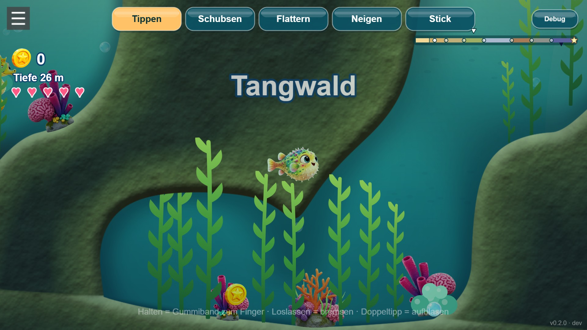

## Biomes, nests, reef world with lighting, abyss

[`2ef5125`](https://github.com/ManuelKugelmann/SuperLompiLand/commit/2ef5125) · 2026-11-13 20:15

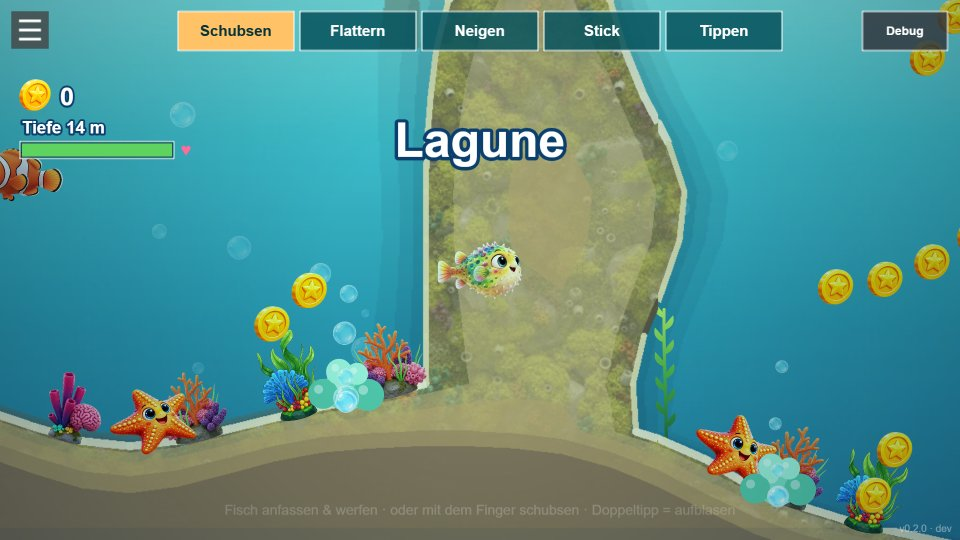

## Boxfish-shaped Lompi, fin animation, puff as air brake

[`6d0f7c5`](https://github.com/ManuelKugelmann/SuperLompiLand/commit/6d0f7c5) · 2026-11-13 19:41

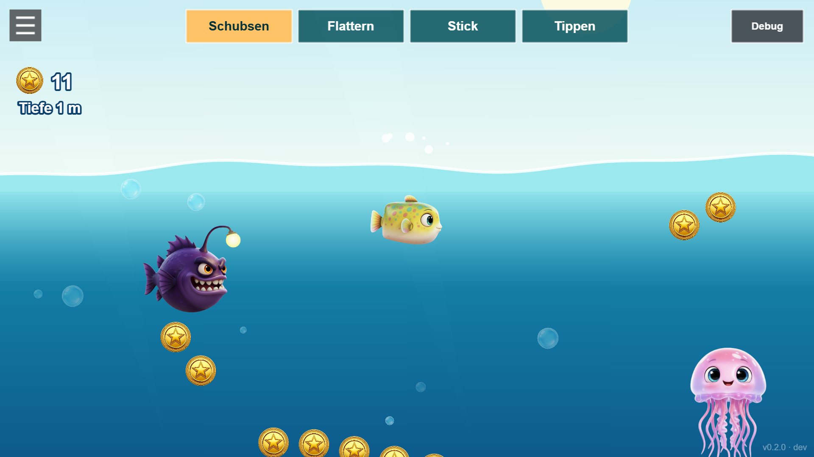

## Waves at the surface, jumping out of the water

[`47d2cff`](https://github.com/ManuelKugelmann/SuperLompiLand/commit/47d2cff) · 2026-11-13 19:37

## Open 2D ocean with the cast: jellyfish, starfish, angler, friends

[`5ed6327`](https://github.com/ManuelKugelmann/SuperLompiLand/commit/5ed6327) · 2026-11-13 19:28

## Friends, moving enemies, current streams, bubble trail

[`0d3c6de`](https://github.com/ManuelKugelmann/SuperLompiLand/commit/0d3c6de) · 2026-11-13 19:16

## First playable: endless seabed, generated art, shove/flap/stick/tap controls

[`3f4f178`](https://github.com/ManuelKugelmann/SuperLompiLand/commit/3f4f178) · 2026-11-13 19:14

